# 银行电话营销响应预测：从数据到投放决策

> 目标是回答一个问题：**在拨号之前，应该把有限的坐席时间花在谁身上？**
> 用 19 个拨号前可得字段建成可解释的排序模型（逻辑回归 + 等渗校准），
> 在按活动月严格留出的测试集上，top-20% 名单的认购率为 **21.0%**
> （基准 8.8%，**2.4×**）；在容量受限时，每千人利润比
> 「全量拨打」高 **€378**。
> 项目同时量化了两个最常见的评估陷阱：`duration` 泄漏让 AP 从 0.292 虚增到 0.497；
> 随机切分让 AP 从 0.247 虚增到 0.493。

---

## 0. 关键数字

| 指标 | 数值 | 说明 |
|---|---|---|
| 样本量 | 41,188（21 列） | 12 条完全重复，无缺失值 |
| 正类率 | 11.27% | 不平衡比约 1:7.9 |
| 评估方式 | 按活动月分组留出 | 训练 24,619 / 测试 16,569，测试集不含训练月份 |
| 平均精度 AP | 0.247（95% CI 0.226–0.270） | 基准 0.088 |
| ROC-AUC | 0.713（95% CI 0.699–0.729） | 跨月仍能排序 |
| top-20% 精确率 | 21.0% | lift 2.4×，召回 48.5% |
| 每千人利润 | €2,393 | 全量拨打 €2,016 |
| Brier / 校准 | 0.120 | 平均预测 30.1% vs 实际 8.8%，**跨月明显高估** |

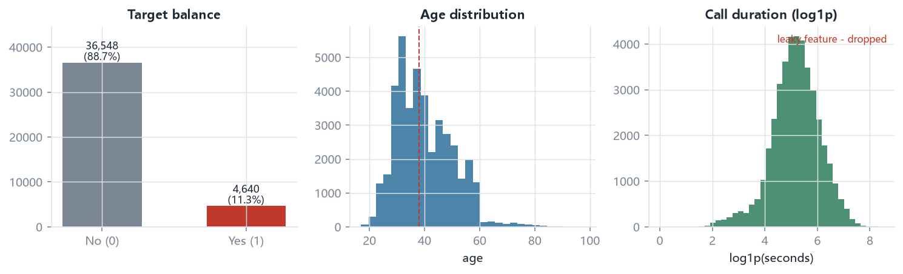

---

## 1. 业务问题

电话营销的瓶颈不是「模型准不准」，而是**名单有限、通话成本真实存在**：

- 一次外呼的成本（坐席时间 + 线路）约 €5；
- 一次成功认购的净贡献约 €80；
- 坐席一天能覆盖的名单只占潜在客户的 20%。

因此任务分成三步：**估计 p(认购 | 拨号前信息) → 按 p 排序 → 在容量约束下切名单**。
评估也据此选择 AP（不平衡下的排序质量）、top-k 精确率（容量约束的实际产出）
和 Brier（概率能否直接算期望收益），而不是 accuracy——全猜「不买」就有 88.7% 准确率。

---

## 2. 数据与探索

UCI Bank Marketing：葡萄牙某银行 2008–2010 年的电话营销记录，41,188 条。
字段分四组：

| 组别 | 字段 | 备注 |
|---|---|---|
| 客户画像 | age, job, marital, education | 静态信息 |
| 产品关系 | default, housing, loan | 已有信贷情况 |
| 本次活动 | contact, month, day_of_week, campaign, **duration** | duration 通话结束后才知道 |
| 历史活动 | pdays, previous, poutcome | 上次接触结果 |
| 宏观环境 | emp_var_rate, cons_price_idx, cons_conf_idx, euribor3m, nr_employed | **月级常数** |

没有显式缺失值（0 个空单元格），但 `unknown` 类别占了一定比例
（education 4.2%、default
20.9%）；`pdays=999` 表示「从未联系过」，
占 96.3%，是哨兵值而非数值。

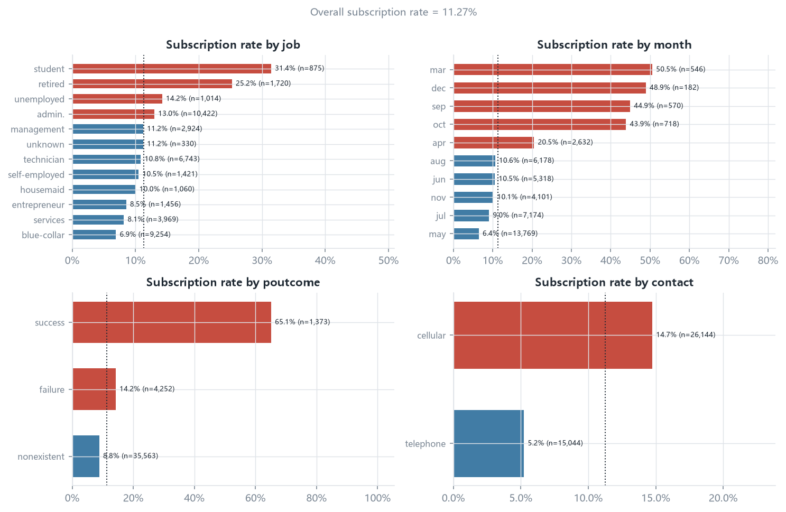

三个最直观的规律：上次活动成功（poutcome=success）的客户认购率
65.1%；cellular 明显优于 telephone；月份之间差异巨大（3%–50%）。

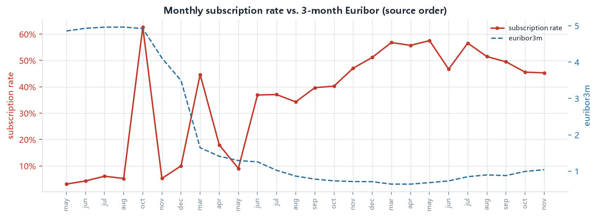

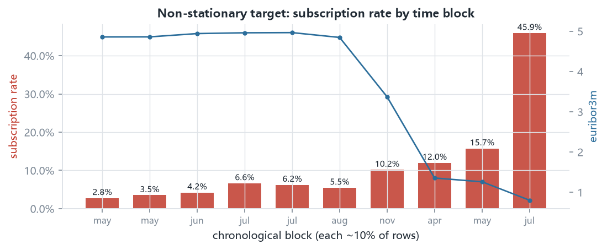

按时间切成 10 段，正类率从早期约 3% 涨到末期约 46%。**这不是噪声，而是目标本身在漂移**，
它决定了后面的验证方式，也解释了为什么「概率」比「排名」更难迁移。

---

## 3. 特征工程与防泄漏

`DomainFeatures` 只做四件事，全部可在 `src/features.py` 审计：

| 派生特征 | 定义 | 动机 |
|---|---|---|
| `contacted_before` | pdays != 999 | 区分「从未联系」与「联系过」 |
| `pdays_known` | pdays=999 → 缺失 | 不把哨兵值 999 当成「999 天前」 |
| `campaign_log` | log1p(campaign) | 压缩长尾 |
| `previous_log` | log1p(previous) | 同上 |

类别特征 one-hot，出现频率低于 0.2% 的稀有水平合并；数值特征中位数填补，
逻辑回归额外标准化。**`duration` 在特征层被强制删除**，并有单元测试守着。

### 3.1 duration 必须丢掉

通话时长与结果高度相关，但只有电话打完之后才有。把它喂给模型，指标会非常漂亮，
上线却拿不到这个输入：

| 模型 | AP（不含） | AP（含） | AUC（不含） | AUC（含） |
|---|---|---|---|---|
| HistGradientBoosting | 0.229 | 0.387 | 0.706 | 0.882 |
| 逻辑回归 | 0.292 | 0.497 | 0.747 | 0.921 |

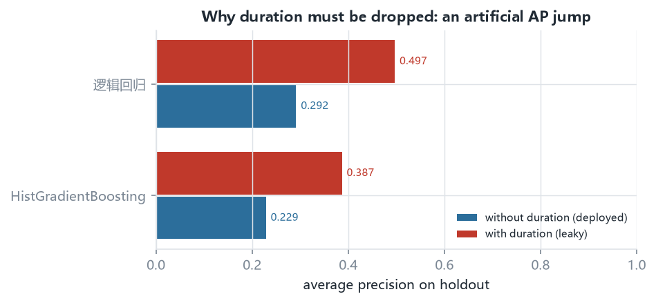

逻辑回归的 AP 从 **0.292 跳到 0.497**、AUC 从 0.747 跳到 0.921——这 20 多个点
全部来自目标泄漏。这是本项目最重要的「不要做」清单第一条。

---

## 4. 验证策略：三种切分的对照

同一份数据、同一个模型配置（默认 HistGradientBoosting，用来隔离切分的影响），
只改变切分方式，结论完全不同：

| 切分方式 | 正类率（训练→测试） | AP | AUC | Brier |
|---|---|---|---|---|
| 随机 80/20 | 11.3% → 11.3% | 0.493 | 0.814 | 0.074 |
| 按活动月分组（主评估） | 12.9% → 8.8% | 0.229 | 0.706 | 0.122 |
| 时间外推（压力测试） | 6.4% → 30.8% | 0.439 | 0.648 | 0.245 |

1. **随机 80/20**：训练/测试同分布，指标最好看，但**同一活动月会同时出现在两边**。
   `euribor3m`、`nr_employed` 这类月级常数等于给模型一个「月份指纹」，
   它可以把测试期「认出来」。同一模型配置下，AP 从 0.229 抬到 0.493、AUC 从
   0.706 抬到 0.814——这就是随机切分的乐观偏差。
2. **按活动月分组**（本项目主评估）：整月留出，训练集与测试集没有共同月份。
   这是更接近部署的估计，也是本报告所有主数字的来源。
3. **时间外推**：前 80% 训练、后 20% 测试。训练期正类率 6.4%、测试期 30.8%，
   概率整体偏低（Brier 0.245），但 AUC 掉到 0.648——跨期排序能力明显退化。
   注意此时 AP 反而有 0.439，**因为 AP 会随正类率上升而上升，不能跨数据集比较**，
   跨期比较应看 AUC 或 lift。

**主评估的一个诚实说明**：按活动月留出只抽到 5 个月，其中 may 2008 占了测试集
82% 的样本、认购率仅 5.6%，所以 0.247 是一个**偏悲观**的单波次估计；
5 折 GroupKFold（每个月都被测试一次）的平均 AP 是 0.41。两个数一起看，
比只报一个更好。

---

## 5. 模型对比与调参

5 折 GroupKFold（按活动月分组，仅训练集）：

| 模型 | AP 均值 | AP 标准差 | AUC | LogLoss |
|---|---|---|---|---|
| 逻辑回归 | 0.254 | ±0.267 | 0.593 | 0.343 |
| 随机森林 | 0.239 | ±0.254 | 0.581 | 0.421 |
| HistGradientBoosting | 0.222 | ±0.240 | 0.564 | 0.499 |
| Dummy（先验概率） | 0.142 | ±0.167 | 0.500 | 0.469 |

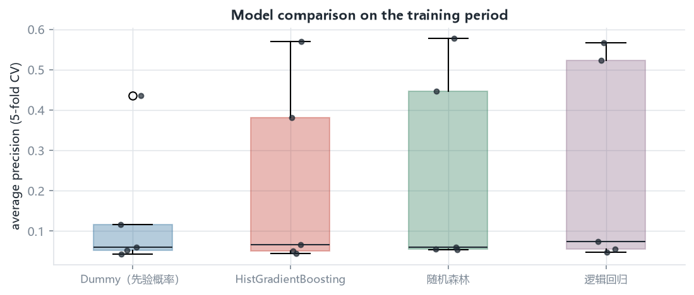

标准差很大（±0.2），因为每一折都是一个或几个完整月份，月份之间基准率差异极大——
这本身就是「数据非平稳」的证据。调参使用 4 折 GroupKFold + 随机搜索：

| 模型 | 最佳 CV AP | 折间标准差 | 最佳参数 |
|---|---|---|---|
| 逻辑回归 | 0.412 | ±0.195 | C=0.07459, class_weight=None |
| HistGradientBoosting | 0.415 | ±0.200 | l2_regularization=0.03149, learning_rate=0.03, max_leaf_nodes=29, min_samples_leaf=91 |

**选择规则：1-SE 规则**。两个模型的最佳 CV AP 只差 0.002，远小于折间标准差；
在「简单模型不劣于最佳模型 1 个标准误」时优先选简单模型，于是最终选中
**逻辑回归 + 校准**（校准：isotonic）。它在留出集上的 AP
（0.247）也略高于 HistGradientBoosting
（0.237），配对 bootstrap 差值
+0.010（95% CI [-0.004, +0.022]，
p≈0.13）——差异不显著，没有理由为 0.002 的 CV 提升付出
可解释性和维护成本。

---

## 6. 阈值与容量约束

概率不是终点，名单才是。这里对比三种策略：

| 策略 | 阈值 | 含义 |
|---|---|---|
| 默认 0.5 | 0.5 | 教科书默认，几乎没人用 |
| 利润最优 | 在训练集 OOF 上搜索 | 边际收益为 0 时停，但依赖概率校准 |
| 容量约束 | **测试批次内取 top-20% 分位** | 坐席一天只能打这么多，实际最常用 |

| 指标 | 默认 0.5 | top-20% 容量 |
|---|---|---|
| 阈值 | 0.500 | 0.425 |
| 触达比例 | 3.5% | 20.2% |
| 精确率 | 44.3% | 21.0% |
| 召回率 | 17.9% | 48.5% |
| F1 | 0.255 | 0.294 |

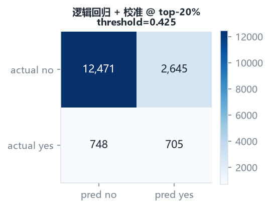

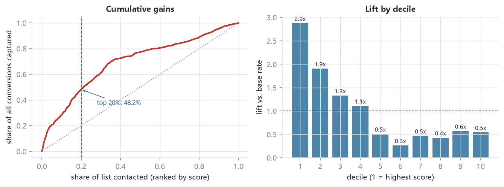

0.5 在这个场景没有意义：只触达 3.5% 的名单，召回
17.9%。容量策略按批次取分位，不依赖绝对概率——**在跨月校准失效时，
这是唯一稳健的用法**（见第 8 节）。

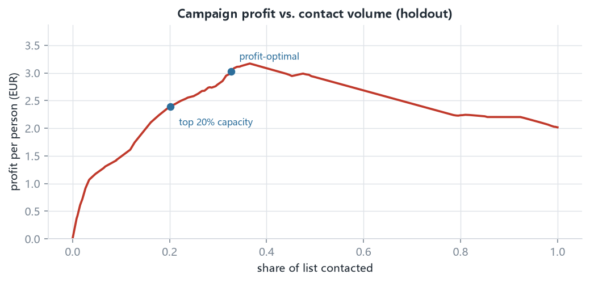

---

## 7. 业务收益与敏感性

留出集（16,569 人）上的三种打法：

| 策略 | 触达人数 | 转化人数 | 利润 | 人均利润 |
|---|---|---|---|---|
| 全量拨打 | 16,569 | 1,453 | €33,395 | €2.02 |
| 随机 20% | 3,314 | 291 | €6,678 | €0.40 |
| 模型 top-20% | 3,350 | 705 | €39,650 | €2.39 |

在同样 20% 的触达量下，模型带来 €2.39/人，是全量拨打
（€2.02）的
**1.2×**，
比随机 20%（€0.40）高 **€1.99/人**。
注意这里的对照是「同样触达量」，而不是「不打电话」——全量拨打本身也是赚的。

收益依赖 €80 / €5 两个假设，
因此做了敏感性分析：

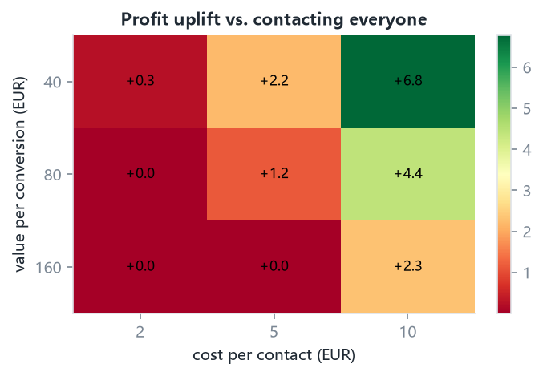

| value \ cost | €2 | €5 | €10 |
|---|---|---|---|
| €40 | +0.3 | +2.2 | +6.8 |
| €80 | +0.0 | +1.2 | +4.4 |
| €160 | +0.0 | +0.0 | +2.3 |

单次转化价值越低、成本越高，「全量拨打」越容易亏钱，排序带来的相对增量就越大
（€40/€10 一档为 +6.8）；反过来，当价值/成本足够高时，每个人打电话都划算，
模型的作用退化为「省一点成本」（€160/€2 一档接近 0）。这决定了项目在什么业务
条件下值得做：**先看单位经济模型，再谈模型提升**。

---

## 8. 可解释性

### 8.1 置换重要性（留出集，AP 下降）

| 特征 | AP 下降（均值） | 标准差 |
|---|---|---|
| emp_var_rate | 0.0706 | 0.0045 |
| nr_employed | 0.0580 | 0.0021 |
| pdays | 0.0568 | 0.0032 |
| cons_price_idx | 0.0471 | 0.0025 |
| euribor3m | 0.0389 | 0.0032 |
| contact | 0.0240 | 0.0049 |
| cons_conf_idx | 0.0031 | 0.0017 |
| job | 0.0025 | 0.0008 |
| default | 0.0019 | 0.0009 |
| poutcome | 0.0010 | 0.0020 |

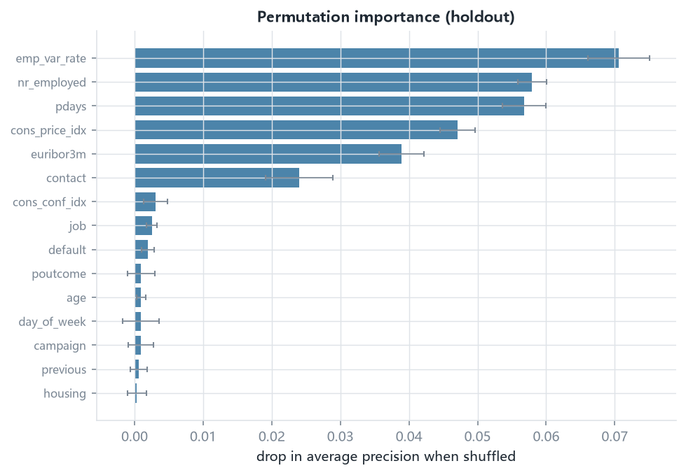

宏观变量排在最前，符合 EDA；但它们是**月级常数**，只能解释「哪个月更好」，
不能区分同一个月内的客户——这正是第 4 节随机切分被高估的根源。

### 8.2 逻辑回归系数（最终模型本身就是可解释的）

| 特征 | odds ratio | 系数 |
|---|---|---|
| month_mar | 1.95 | +0.666 |
| cons_price_idx | 1.54 | +0.431 |
| month_apr | 1.36 | +0.309 |
| contacted_before | 1.31 | +0.270 |
| euribor3m | 1.30 | +0.259 |
| contact_cellular | 1.27 | +0.239 |
| campaign_log | 1.23 | +0.204 |
| poutcome_failure | 0.77 | -0.264 |
| contact_telephone | 0.77 | -0.265 |
| nr_employed | 0.72 | -0.329 |
| campaign | 0.72 | -0.332 |
| month_jun | 0.68 | -0.389 |
| month_nov | 0.52 | -0.654 |
| emp_var_rate | 0.34 | -1.073 |

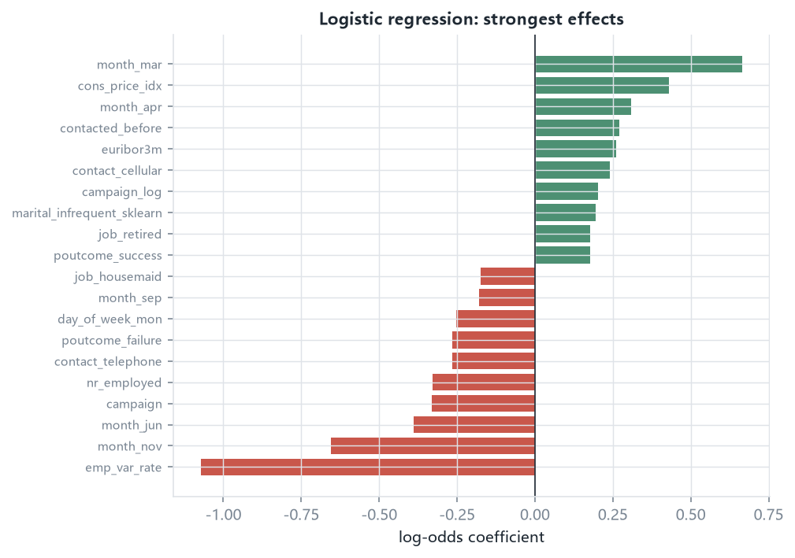

上次活动成功、cellular 联系方式、被联系过、较低的 emp_var_rate 都提升认购赔率；
`campaign` 越大赔率越低——同一活动里反复拨打会快速消耗意愿。
注意宏观变量之间高度共线（euribor3m / nr_employed / emp_var_rate），
系数符号不宜单独作因果解读。

### 8.3 校准为什么失效

留出集平均预测 30.1%，实际只有 8.8%，Brier
0.120——模型在没见过的月份上系统性高估。原因是训练月份的基准率
（12.9%）高于测试月份（8.8%），且宏观特征在测试月份处于训练分布之外。
校准方法是在训练集内部的**随机**留出上选的（isotonic Brier 0.0868 vs raw 0.0870），
这个选择在跨月时没有迁移——**校准本身也需要按时间验证**，这是下一次迭代要补的。
**结论：概率只在「同分布」时可信；跨月投放应使用排名/分位数，并在新月份上重新校准。**

（因此本报告不把「利润最优阈值」当作推荐策略，只保留容量约束的 top-k 方案。）

---

## 9. 误差分析

### 9.1 分群可靠性（实际 vs 平均预测）

| job | 样本数 | 实际认购率 | 平均预测 | 偏差 |
|---|---|---|---|---|
| management | 1109 | 7.5% | 31.5% | -24.0pp |
| self-employed | 530 | 9.6% | 31.8% | -22.2pp |
| blue-collar | 4773 | 6.0% | 28.1% | -22.1pp |
| services | 1956 | 6.8% | 28.5% | -21.7pp |
| technician | 2240 | 9.8% | 31.0% | -21.3pp |

偏差最大的群体说明模型在该群体上系统性高估/低估；上线后应按群体监控
「预测均值 vs 实际转化」。**注意这里的偏差主要是全局校准漂移**（所有群体的平均
预测都在 28–32%，实际只有 6–10%），不是某个群体单独出了问题；分群监控的价值在于
发现「漂移幅度不同」的群体，而不是把全局偏差归因到某个 job 上。

### 9.2 四类样本画像（top-20% 阈值）

| 类别 | 人数 | 平均年龄 | 平均拨打次数 | 平均预测 |
|---|---|---|---|---|
| FN | 748 | 39 | 2.2 | 0.279 |
| FP | 2645 | 39 | 1.9 | 0.459 |
| TN | 12471 | 39 | 2.5 | 0.256 |
| TP | 705 | 41 | 1.8 | 0.513 |

FN（漏掉的高意愿客户）平均预测并不低，说明其中一部分是信息缺失而非排序错误；
FP 集中在「画像像成功客户、但本期没买」的人群，适合二次触达或换渠道。

---

## 10. 局限与上线建议

**局限**

1. **单一波次留出**：测试集 82% 来自 may 2008（5.6%），0.247 是悲观估计；
   跨月平均（GroupKFold）是 0.41。两者都应报告。
2. **概率不可跨期迁移**：Brier 0.120，平均预测 30.1% vs 实际
   8.8%；只能用于排序，或在新数据上重校准。
3. **观测数据，无随机对照**：模型学的是「谁更可能买」，不是「打电话让谁多买」；
   真正的增量需要 A/B 或 uplift 模型。
4. **成本/价值是假设**：€80 / €5
   仅用于演示，换真实财务口径后阈值与结论都要重算。
5. **公平性未展开**：age、marital 等属性进入了模型，上线前应做分群 TPR/FPR 审计。

**上线路径**

1. 每日批量打分（`src/predict.py`），按当天名单取 top-k，而不是固定阈值；
2. 10% 流量做冠军-挑战者对照，监控 AUC、top-k 精确率与分群校准；
3. 每月用最近 3 个月数据重训 + 重校准，PSI 监控 `euribor3m`、`poutcome`；
4. 保留逻辑回归作为可解释基线，GBDT 只在跨月验证有稳定增益时才替换。

---

## 11. 复现

```powershell
# 1) 依赖（沙箱内无法用 pip，脚本直接下 wheel 并解压）
python scripts/bootstrap_env.py --only download
python scripts/bootstrap_env.py --only extract
$env:PYTHONPATH = "$PWD;$PWD\.pydeps"

# 2) 全流程（约 5 分钟，单核）
python run_all.py

# 3) 单独打分
python -m src.predict --input new_calls.csv --output scored.csv
```

产物：`artifacts/model.joblib`（完整 pipeline）、`metrics.json`、图表、
`validation_strategy.csv`（三种切分）、`leakage_experiment.csv`。
随机种子固定为 42。

---

## 12. 面试讲解（5 分钟版）

**30 秒版本**：UCI 银行营销数据，4 万条、11% 正类。我把它做成完整投放链路：
拨号前特征 → 逻辑回归 + 校准 → 按容量取 top-20%。留出集 AUC 0.71，
top-20% 名单认购率 21%（基准 8.8%，2.4 倍），每千人比全量拨打多赚约
€378。更有价值的是两个评估陷阱的量化：
`duration` 泄漏让 AP 从 0.29 涨到 0.50；随机切分让 AP 从 0.25 涨到 0.49。

**四个可能被追问的点**：

1. **为什么不用 accuracy？** 全猜「不买」就有 88.7%；不平衡问题看 AP、top-k 精确率和 lift。
2. **最大的坑？** 两个：`duration` 是通话后信息，加进去 AUC 0.75→0.92，但上线拿不到；
   随机切分让同月样本泄漏宏观特征，AP 虚高一倍。所以主评估按活动月分组。
3. **阈值怎么定？** 不用 0.5；用批次内 top-20% 分位，产能有限时最稳。
   概率校准在跨月时失效（预测 30% vs 实际 8.8%），所以不推荐固定概率阈值。
4. **为什么最终选逻辑回归而不是 GBDT？** 1-SE 规则：两者 CV AP 只差 0.002，
   小于折间标准差；留出集上逻辑回归还略好，且系数可直接解释。复杂模型没有稳定增益。
